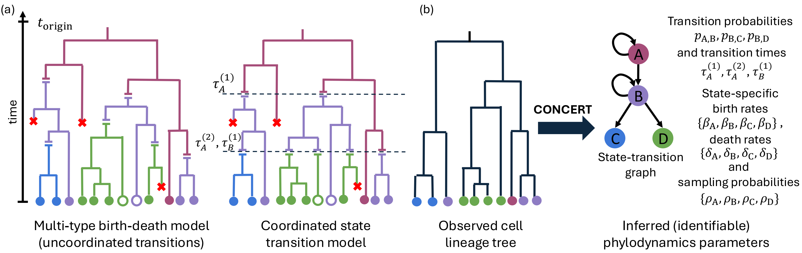

# CONCERT

This repository contains code for **“Phylodynamic Inference with
Coordinated Cell State Transitions.”** It implements the Coordinated State
Transition Model (CSTM) and CONCERT, an inference framework for birth, death,
sampling, and coordinated cell-state transitions on lineage trees.


## Contents

- [Overview](#overview)
- [Installation and setup](#installation-and-setup)
- [Input and output formats](#input-and-output-formats)
  - [Trees and state IDs](#trees-and-state-ids)
  - [Transition graph and time files](#transition-graph-and-time-files)
  - [Inference output](#inference-output)
- [Quickstart](#quickstart)
- [Simulation studies](#simulation-studies)
- [TLS and TLSC](#tls-and-tlsc)
- [CRC11](#crc11)
- [CSTM–BDT-CTMC convergence](#cstm-bdt-ctmc-convergence)
- [Repository layout](#repository-layout)
- [Retained analysis notebooks](#retained-analysis-notebooks)

## Overview



CONCERT implements the Coordinated State Transition Model (CSTM), a
multi-type birth-death model for lineage trees whose lineages occupy discrete
cell states. State-specific birth, death, and sampling rates describe lineage
dynamics; a directed transition graph describes which cell-state changes are
allowed. CSTM accounts for coordinated state changes at shared times in the
lineage history. CONCERT uses observed lineage-tree structure and sampled-tip
states to estimate model rates, transition probabilities, and transition times.

## Installation and setup

The checked-in example was run with Python 3.13 and PyTorch 2.14. 

```bash
git clone https://github.com/sashittal-group/phylodynamic-CARTA.git
cd phylodynamic-CARTA
python3 -m venv .venv
source .venv/bin/activate
python -m pip install --upgrade pip
python -m pip install torch numpy pandas scipy networkx matplotlib pyyaml
```

The packages above support CONCERT inference and the included simulation
example. To run Snakemake workflows, install Snakemake as well:

```bash
python -m pip install snakemake
```

## Input and output formats

### Trees and state IDs

Each tree is represented by a matching `nodes.csv` and `edges.csv` pair.
CONCERT searches the input directory recursively and pairs files by replacing
`edges` with `nodes` in the filename. The included example has one pair in each
`tree_N/` directory.

`nodes.csv` has one row per node:

```csv
node_id,T,is_leaf,state_id
0,1.0,0,-1
5,0.6413474828,0,-1
42,0.0,1,3
```

`node_id` is unique within the tree. `is_leaf` is `1` for a sampled tip and
`0` otherwise. A sampled tip's `state_id` is a zero-based state index; `-1`
can be used when an internal node's state is unknown. State IDs follow the
order in the setting, so the example maps A, B, C, D to 0, 1, 2, 3.

The tree time coordinate `T` is ordered as in leaf-to-root order: the root
at 1 and extant tips at 0. It therefore decreases along a directed
parent-to-child edge. `edges.csv` contains one row per directed edge:

```csv
parent,child,branch_length
0,5,0.3586525172
5,6,0.0681977328
```

The branch length is the difference between the parent's and child's `T`.
Keep each tree's node and edge files together and preserve the parent-to-child
orientation.

### Transition graph and time files

The file passed to `--transition-edges-file` has no header; each line is a
zero-based `source_state target_state` pair. The linear example's file is:

```text
2 3
1 2
0 1
```

This declares the allowed transitions C→D, B→C, and A→B. The file lists
allowed edges, not a chronological schedule. A copy for the example is
included at `examples/linear_A_to_D/input/transition_edges_linear.txt`.

### Inference output

The required `--output` file is a plain-text fit summary. The default
joint-inference format contains:

```text
LL=...
birth: ...
death: ...
sampling: ...
transitions:
0->0 ...
0->1 ...
...
transition_times:
0 ...
1 ...
...
```

The rate and probability vectors use the state-ID order from the input.
`transitions` lists the estimated probabilities for self-transitions and
allowed directed edges. `transition_times` lists the fitted leaf-to-root ordered 
schedule. (Note: 
The simulator's `transition_times.csv` is in the opposite order: 
it begins with an event count and then lists
realized forward simulation times.) `--log` writes optimizer iterations; standard output reports
progress and standard error contains diagnostic messages.

## Quickstart

The example under `examples/linear_A_to_D/` eight
simulated A→B→C→D trees. A `setting.txt` file is the simulator's ground truth: it
defines the state order, birth/death/sampling rates, forward transition
schedule, transition probabilities, initial state, simulation horizon, and
requested number of trees. 

Run the default CONCERT mode from the repository root:

```bash
OMP_NUM_THREADS=1 python -m src.concert examples/linear_A_to_D/input \
  --num-states 4 \
  --num-trees 8 \
  --transition-edges-file examples/linear_A_to_D/input/transition_edges_linear.txt \
  --num-transition-times 3 \
  --output examples/linear_A_to_D/output/inference.out \
  --log examples/linear_A_to_D/output/inference.log
```

`OMP_NUM_THREADS=1` limits the
compiled CPU kernel to one OpenMP thread; an uncapped run stalled at an
OpenMP barrier in this environment. This only changes CPU parallelism, not the
model inputs. Use
`python -m src.concert examples/linear_A_to_D/input --help` to see the
default-mode arguments.

The included setting is a simulation reference, not an inference
configuration. In state order A, B, C, D it has birth rates 6, 12, 8, 8;
death rates 2, 4, 2, 1; and sampling rates 0.5 per state. For example,
the A transition row is A→A = 0.203 and A→B = 0.797. The schedule and
transition rows in the setting provide the known values against which a fit
can be assessed.

After the run, open `examples/linear_A_to_D/output/inference.out`. Read
`birth`, `death`, and `sampling` in state-ID order; read `transitions` as
source-to-target probabilities; and read `transition_times` as the ordered
normalized schedule described above. The corresponding iteration history is
in `inference.log`.


## Repository layout

- `src/concert/` contains the shared CONCERT tree, likelihood, optimization, and
  inference implementation.
- `src/analyses/common/` contains reusable profile, plotting, and tree-data
  utilities.
- `src/analyses/simulation/`, `tls/`, `crc11/`, and `bdt_ctmc/`
  contain code and configuration specific to each result group.
- `examples/linear_A_to_D/` contains an eight-tree input dataset and its
  CONCERT inference output.
- `data/` stores study inputs, simulated trees, and full inference fits;
  `outputs/` stores figures and compact analysis summaries.


## Simulation studies

The comparison workflow evaluates CONCERT against diversitree, BEAM, and
MACH2 on four-state star and linear transition graphs. The inference-completed
comparison covers the 20 configured star and 20 configured linear
setting/batch combinations, using the eight trees in each batch.
For the linear simulation workflow, the Snakemake rules are
`generate_linear_transition_settings`, `simulate_linear_transition_3`, and
`infer_linear_transition_3_joint_coordinate_first8`; the latter fits the
state-specific A → B → C → D transition times together with the model
parameters. The smaller checked-in example above uses the same inference
application without requiring the full configured simulation set.

1. Generate the star settings. The linear settings are generated by the
   Snakemake workflow when needed:

   ```bash
   python -m src.concert --analysis generate-star-transition-settings \
     --output-root data/simulation/coord_diff \
     --num-settings 100
   ```

2. Run the comparison:

   ```bash
   snakemake coord_diff_inference_completed_batches_methods
   ```

   This target requires the comparison software and its configuration to be
   available. It writes simulated trees and per-tree method results under
   `data/simulation/coord_diff/`.

3. Generate plots from completed inference outputs:

   ```bash
   python -m src.analyses.simulation.plot_star_inference_accuracy \
     --data-dir data/simulation/coord_diff/star_3 \
     --progressive-transition-times 3

   python -m src.concert --analysis plot-linear-transition-inference-accuracy \
     --data-dir data/simulation/coord_diff/linear_A_to_D

   python -m src.concert --analysis plot-linear-transition-inference-accuracy \
     --data-dir data/simulation/coord_diff/linear_A_to_D \
     --transition-time-errors
   ```


## TLS and TLSC

The root workflow target for the configured fixed-sampling TLS/TLSC analysis
is:

```bash
snakemake tls_fixed_sampling_01
```

It uses the subtree exports under `data/troupe/`, writes fits under each
dataset's `data/troupe/<dataset>/fixed_sampling_0.1/` directory, and writes
profile tables and figures under `outputs/tls/fixed_sampling_0.1/`.

For the manuscript’s 100-transition-time profile analysis, use the completed
inference files/checkpoints and regenerate profiles and comparison plots:

```bash
python -m src.analyses.tls.profile_transition_run \
  data/troupe/TLS/fixed_sampling_0.1/inference_transition_times_100.tmp.out

python -m src.analyses.tls.profile_transition_run \
  data/troupe/TLSC/fixed_sampling_0.1/inference_transition_times_100.out

python -m src.analyses.tls.compare_transition_profiles \
  --tls-profiles outputs/tls/fixed_sampling_0.1/transition_profiles/TLS/data/TLS_transition_times_100 \
  --tlsc-profiles outputs/tls/fixed_sampling_0.1/transition_profiles/TLSC/data/TLSC_transition_times_100

python -m src.analyses.tls.figure_generator
```

To reproduce the state-colored
subtree plots after the 100-transition fits are available, run:

```bash
python -m src.analyses.tls.process_state_coloring --dataset TLS
python -m src.analyses.tls.process_state_coloring --dataset TLSC
python -m src.analyses.tls.plot_state_coloring --dataset TLS
python -m src.analyses.tls.plot_state_coloring --dataset TLSC
```


## CRC11

The CRC11 result fits a state-specific NC → PT → LN model, compares candidate
numbers of PT → LN transition times, and generates the manuscript figure.
Its prepared transition-chain input is expected at
`data/sgootr/all_trees/combined_inference/S10_CRC11_transition_chain_input/`.
The input directory must contain the tree and transition files consumed by
the inference scripts.

If the raw CRC11 tree and preprocessing tools are available, the general
SGOOTR processing pipeline can be run with:

```bash
python -m src.analyses.crc11.preprocessing.pipeline
```

This pipeline expects `data/sgootr/CRC11.nwk` by default and LSD2/MACH2 on
`PATH` or in the project environment. It does not by itself create the
prepared `S10_CRC11_transition_chain_input` directory; see
[the SGOOTR processing notes](src/analyses/crc11/PREPROCESSING.md) for its
preprocessing stages.

The CRC11 inference and downstream results are available as named Snakemake
targets. They require the prepared S10 input directory above. Run the full
workflow with:

```bash
snakemake sgootr_crc11_results
```

This aggregate includes the full schedule search (up to 10 cohorts of 500
schedules), the fixed-time fit for the manuscript's selected schedule 3857,
the selected-fit profiles and tree visualization, the one-through-five
PT → LN transition-count analysis, and the manuscript figure. The search and
transition-count analysis are computationally expensive. To run or rerun only
one stage, use its individual target:

```bash
snakemake sgootr_crc11_schedule_search
snakemake sgootr_crc11_fit_schedule_3857
snakemake sgootr_crc11_selected_fit_plots
snakemake sgootr_crc11_transition_count_analysis
snakemake sgootr_crc11_manuscript_figure
```

The fixed fit uses NC → PT at 0.356 and PT → LN at 0.131 and 0.282. Each
target writes to a separate `_snakemake` output location so it will not
overwrite the existing manuscript results. The search results and full fits
are written under `data/sgootr/all_trees/combined_inference/`; summaries,
profiles, plots, and the figure are written under `outputs/sgootr/`.

The figure is assembled from the fixed schedule-3857 fit. A fresh schedule
search may select another schedule; the fixed-fit target intentionally
recreates the fit associated with the current manuscript figure. Additional
state-specific fitting, profiling, and plotting commands are in
[the CRC11 workflow notes](src/analyses/crc11/README.md) and
[the state-specific transition notes](src/analyses/crc11/README_state_specific_transitions.md).

## CSTM–BDT-CTMC convergence

Supplementary Sec. B.1 compares CSTM likelihoods across increasing numbers of
transition times on 100 simulated trees. The CSTM computation is:

```bash
python -m src.analyses.bdt_ctmc.compare_cstm_bdt_ctmc
```

It reads trees from
`data/simulation/bdt_ctmc/emperical_proof_data/tree_001/` through
`tree_100/` and writes the compact likelihood table to
`outputs/supplementary/bdt_ctmc/tree_likelihoods_cstm.txt`.
The retained `infer` rule in the `Snakefile` runs the BDT-CTMC companion
executable for a prepared setting, but that executable and the setting inputs
are not included in this repository. For a setting named `SETTING_NAME`, its
target is:

```bash
snakemake data/simulation/bdt_ctmc/SETTING_NAME/inference.out
```

The aggregate BDT-CTMC likelihood table belongs alongside the CSTM table at
`outputs/supplementary/bdt_ctmc/tree_likelihoods.txt`.
The convergence plot is in
[`notebooks/cstm_vs_ctmc.ipynb`](notebooks/cstm_vs_ctmc.ipynb); open and run it
after producing both CSTM and BDT-CTMC likelihood files:


The notebook saves its convergence figures under
`outputs/supplementary/bdt_ctmc/`.

## Analysis notebooks

The repository has notebooks used for paper results and supplementary
analysis:

- [`notebooks/TLS_100_transition_methods_and_results.ipynb`](notebooks/TLS_100_transition_methods_and_results.ipynb)
- [`notebooks/tls_transition_resolution_stability.ipynb`](notebooks/tls_transition_resolution_stability.ipynb)
- [`notebooks/SGOOTR_CRC11_methods_and_results.ipynb`](notebooks/SGOOTR_CRC11_methods_and_results.ipynb)
- [`notebooks/cstm_vs_ctmc.ipynb`](notebooks/cstm_vs_ctmc.ipynb)
